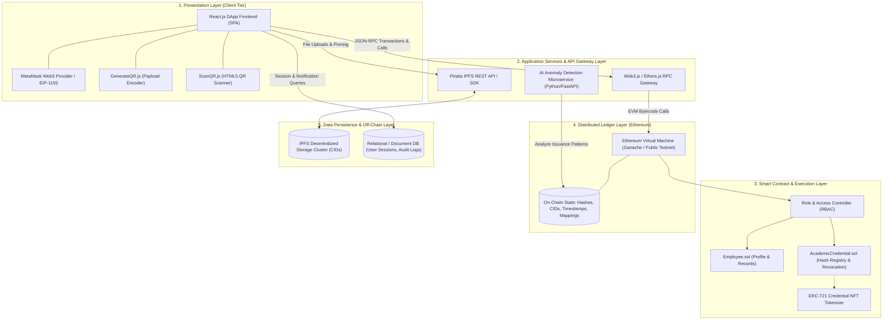
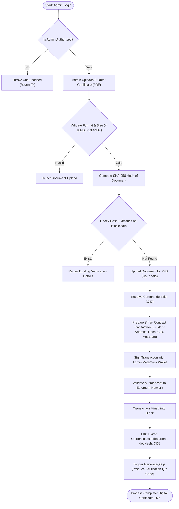
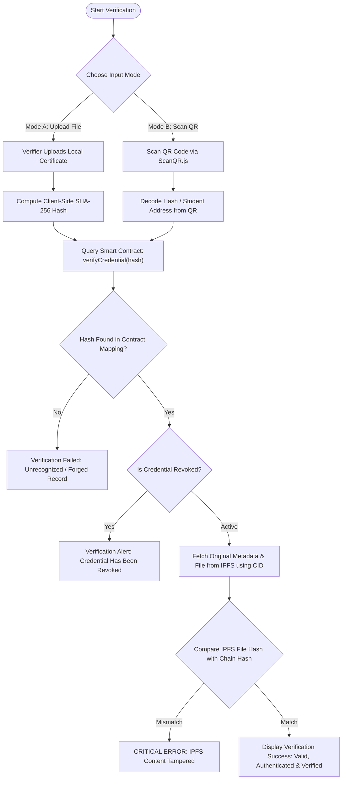
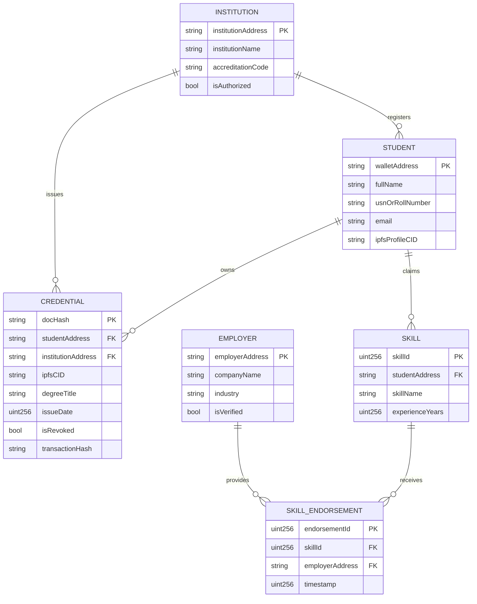

# System Architecture & Detailed Design Specification

<div align="center">
  
</div>

## Project: Blockchain-Based Academic Record Verification System
**Course / Phase:** Project Phase-II (BCS758)  
**Institution:** Department of Computer Science and Engineering, Navkis College of Engineering (VTU)

---

## 1. Executive Summary & Design Principles

The **Blockchain-Based Academic Record Verification System** is designed to eliminate centralized credential forgery, reduce administrative overhead, and enable instant, cross-institutional academic verification. 

The architecture adheres to four core engineering principles:
1. **Decentralization of Trust:** Trust is anchored in Ethereum-compatible consensus and smart contracts rather than a single database or institutional server.
2. **On-Chain / Off-Chain Data Segregation:** To optimize gas efficiency and maintain privacy, heavy digital assets (PDF certificates, images) remain off-chain in content-addressed storage (IPFS), while only cryptographic hashes (SHA-256), IPFS Content Identifiers (CIDs), and verifiable metadata live on-chain.
3. **Multi-Tiered Verification:** Verification can be conducted both by direct cryptographic lookup (via hash comparison) and high-convenience mobile scanning (via embedded QR codes).
4. **Defense in Depth:** An integrated machine-learning pipeline analyzes transaction patterns and metadata anomalies to flag unauthorized issuance behavior.

---

## 2. Multi-Tier System Architecture



---

## 3. Layer Breakdown & Component Responsibilities

### 3.1. Layer 1: Presentation Layer (React.js DApp)
- **Role-Aware Dashboards:**
  - **Admin View:** Interface for university registrars to add verified students, approve authorized employers, and issue digital credentials.
  - **Student View:** Enables graduates to view issued degrees, profile data, upload project/course credentials, and generate shareable QR badges.
  - **Employer / Public View:** Unauthenticated or authenticated verification portal providing document hash checks and QR scanning.
- **Client-Side Hashing:** Computes SHA-256 digests in-browser prior to transmission, ensuring raw files can be compared locally without unauthorized data leakage.
- **QR Encoding/Decoding Engine:**
  - `GenerateQR.js`: Encodes a JSON payload containing the Student Wallet Address, Credential ID, and Transaction Hash.
  - `ScanQR.js`: Uses device camera feeds to parse QR codes, extract record IDs, and trigger automated blockchain verification calls.

### 3.2. Layer 2: Application Services & API Gateway
- **Web3 Provider Layer:** Manages JSON-RPC bridge connections via MetaMask, handles nonce calculation, transaction signing, and gas fee estimation.
- **Pinata / IPFS Gateway:** Manages distributed file storage pinning, generating tamper-proof `Qm...` / `bafy...` Content Identifiers (CIDs).
- **ML Anomaly Detection Pipeline:** A standalone Python engine (TensorFlow) that tracks transaction frequencies, unexpected minting volumes, or invalid metadata schema distributions.

### 3.3. Layer 3: Smart Contract & Logic Layer
The smart contract architecture is divided into modular, gas-optimized contracts written in Solidity (v0.8.x):

```
+-------------------------------------------------------------+
|                     AcademicCredential.sol                  |
+-------------------------------------------------------------+
| - Mapping: bytes32 (docHash) => CredentialRecord            |
| - Mapping: address (institution) => bool (isAuthorized)     |
| - Functions:                                                |
|     * issueCredential(address student, bytes32 docHash, ...) |
|     * verifyCredential(bytes32 docHash)                     |
|     * revokeCredential(bytes32 docHash, string reason)      |
+-------------------------------------------------------------+
                              |
                              v
+-------------------------------------------------------------+
|                         Employee.sol                        |
+-------------------------------------------------------------+
| - Mapping: address => StudentProfile                        |
| - Mapping: address => EducationRecord[]                     |
| - Mapping: address => Skill[]                               |
| - Functions:                                                |
|     * registerStudent(name, location, description)          |
|     * addEducationRecord(degree, university, year, grade)   |
|     * addSkill(skillName, experienceYears)                  |
|     * endorseSkill(address student, uint256 skillId)        |
+-------------------------------------------------------------+
```

### 3.4. Layer 4: Distributed Ledger & Consensus Layer
- Employs an EVM-compatible blockchain (Ethereum Testnet / Ganache in development; scalable to Layer-2 networks like Arbitrum / Polygon).
- Guarantees immutability: once a credential hash and issuing timestamp are committed to a block, neither university staff nor external attackers can modify grades or graduation dates without invalidating cryptographic proof.

### 3.5. Layer 5: Data Storage Layer
- **On-Chain:** Minimal footprint (cryptographic hashes `bytes32`, addresses `address`, timestamps `uint256`, and CIDs `string`).
- **Off-Chain IPFS:** Unaltered PDF certificates, transcripts, and institution signatures pinned across decentralized IPFS nodes.
- **Auxiliary Database:** Caches user profiles, email notification queues, and activity logs to optimize front-end rendering performance.

---

## 4. Detailed Data Flow & State Transitions

### 4.1. Document Issuance Pipeline



### 4.2. Third-Party Verification Pipeline



---

## 5. Cryptographic & Security Architecture

### 5.1. Cryptographic Hash Validation
- **Algorithm:** SHA-256 (`256-bit` digest output, formatted as `bytes32` in Solidity).
- **Collision Resistance:** Computationally infeasible for two differing academic documents to produce identical digests ($2^{256}$ keyspace).
- **Zero Raw Data On-Chain:** Student PII (Personally Identifiable Information) is never stored directly as plaintext on the public ledger, conforming to data protection and privacy requirements.

### 5.2. Batch Issuance via Merkle Trees (Advanced Mode)
For large-scale graduation cohorts, individual certificates can be hashed into leaf nodes of a **Merkle Tree**:
- The university calculates intermediate nodes up to the **Merkle Root**.
- Only the single Merkle Root is submitted in one on-chain transaction.
- Verification uses an **Authentication Path** (Sibling Hashes) embedded within the student's QR code, reducing $O(N)$ transaction costs to $O(1)$ deployment cost and $O(\log N)$ verification cost.

### 5.3. Role-Based Access Control (RBAC) Matrix

| Operation | Admin / University | Student / Graduate | Employer / Verifier | Public |
|---|:---:|:---:|:---:|:---:|
| Register Student Address | ✅ | ❌ | ❌ | ❌ |
| Authorize New Institution | ✅ (Owner) | ❌ | ❌ | ❌ |
| Issue / Mint Academic Record | ✅ | ❌ | ❌ | ❌ |
| Revoke Academic Record | ✅ | ❌ | ❌ | ❌ |
| Update Profile & Add Skills | ❌ | ✅ | ❌ | ❌ |
| Endorse Student Skills | ❌ | ❌ | ✅ | ❌ |
| Generate Verification QR | ❌ | ✅ | ❌ | ❌ |
| Verify Document Authenticity | ✅ | ✅ | ✅ | ✅ |

---

## 6. AI/ML Fraud & Anomaly Detection Architecture

```
+-------------------------------------------------------+
|        Ethereum Transaction & Event Stream            |
+-------------------------------------------------------+
                           |
                           v
+-------------------------------------------------------+
|               Data Ingestion & Extraction             |
|   (Block Timestamp, Gas Price, Issuer Address, CID)   |
+-------------------------------------------------------+
                           |
                           v
+-------------------------------------------------------+
|                 Feature Engineering                   |
|   - Issuance frequency spikes per hour                |
|   - Geographical IP variance of issuer                |
|   - Duplicate name vs distinct address ratios         |
|   - Irregular gas limits or off-hour minting          |
+-------------------------------------------------------+
                           |
                           v
+-------------------------------------------------------+
|           TensorFlow Deep Neural Network              |
|        (Multi-Layer Perceptron / Autoencoder)         |
+-------------------------------------------------------+
              |                                   |
              v                                   v
   [Normal Transaction]             [Anomaly Detected (> 0.85 Score)]
              |                                   |
              v                                   v
        Record Verified             Flag Admin / Quarantine Credential
```

The machine learning module is built using **Python and TensorFlow**:
1. **Model:** Semi-supervised Autoencoder trained on normative academic issuance behavior.
2. **Input Features:** Issuance velocity, time-of-day distributions, signer address history, and IPFS metadata schema uniformity.
3. **Outcome:** Generates a real-time risk score. Transactions exceeding threat thresholds notify university auditors for manual review.

---

## 7. Database Entity-Relationship (ER) & State Model

For off-chain relational tracking and quick dashboard queries:



---

## 8. Deployment & Operational Topology

```
+--------------------------------------------------------------------------------+
|                             Cloud / Server Node                                |
|                                                                                |
|  +---------------------------+        +-------------------------------------+  |
|  |     Nginx Reverse Proxy   |        |   FastAPI ML Anomaly Engine         |  |
|  |  (SSL / TLS Termination)  |        |   (Python 3.9+, TensorFlow 2.x)    |  |
|  +-------------+-------------+        +------------------+------------------+  |
|                |                                         |                     |
|  +-------------v-------------+                           |                     |
|  | React Client Static Build |                           |                     |
|  | (Port 80/443 -> 3000)     |                           |                     |
|  +---------------------------+                           |                     |
+----------------|-----------------------------------------|---------------------+
                 |                                         |
                 +-------------------+                     |
                                     |                     |
                     JSON-RPC (EIP-1193)                   |
                                     |                     |
+------------------------------------v---------------------v---------------------+
|                              Decentralized Networks                            |
|                                                                                |
|    +-----------------------------+        +-------------------------------+    |
|    |    Ethereum Node / Ganache  |        |    IPFS Swarm / Pinata Cluster |   |
|    |    Smart Contracts Exec     |        |    Encrypted Certificate Docs |    |
|    +-----------------------------+        +-------------------------------+    |
+--------------------------------------------------------------------------------+
```

---

## 9. Summary & Architecture Compliance

| Requirement | Implementation Strategy | Slide Ref |
|---|---|:---:|
| **Elimination of Paper / Manual Fraud** | SHA-256 Hashing + Ethereum Immutability | Slides 3, 12, 14 |
| **Decentralized Document Access** | IPFS (Pinata) distributed file storage with CIDs | Slides 4, 14, 21 |
| **Instant Verification** | QR Code Generator (`GenerateQR.js`) & Scanner (`ScanQR.js`) | Slides 5, 24, 25 |
| **Role-Based Workflows** | Solidity Smart Contracts (`Employee.sol`, Admin / Student / Employer) | Slides 15, 23, 24 |
| **Suspicious Activity Guardrails** | Neural Network Anomaly Detector (Python/TensorFlow) | Slides 4, 15, 17 |
| **High Volume / Batch Support** | Merkle Tree generation for batch graduation issuance | Slides 6, 9, 26 |
