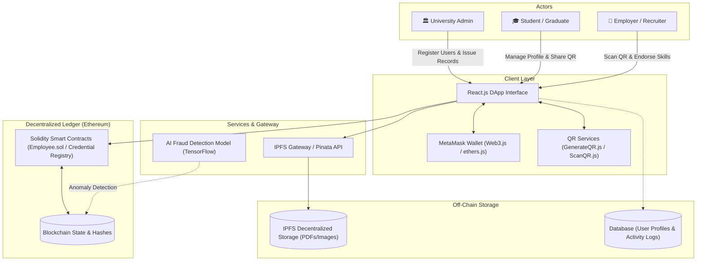
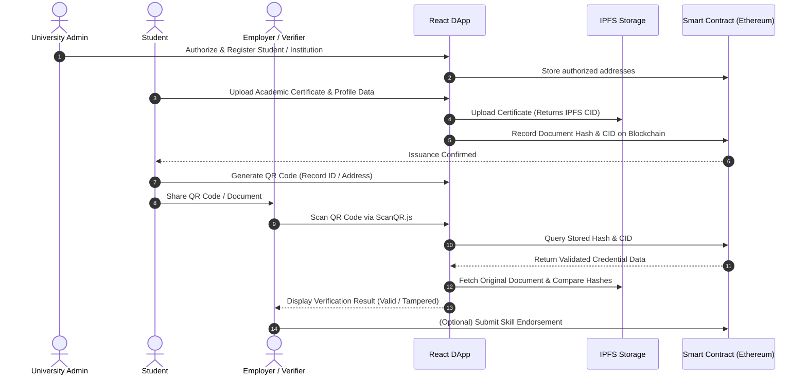

# Blockchain-Based Academic Record Verification System

<div align="center">
  
  
  <p><em>Securing Academic Credentials with Ethereum, IPFS Decentralized Storage, and Instant QR Verification</em></p>
</div>

A decentralized, tamper-proof, and transparent academic record issuance and credential verification platform built using Ethereum smart contracts, IPFS distributed storage, and a React.js decentralized application (DApp).

---

## 📌 Table of Contents

- [Overview](#overview)
- [Key Features](#key-features)
- [System Architecture & Design](#system-architecture--design)
- [Technology Stack](#technology-stack)
- [User Roles & Workflow](#user-roles--workflow)
- [Project Directory Structure](#project-directory-structure)
- [Prerequisites](#prerequisites)
- [Installation & Setup](#installation--setup)
- [Smart Contract Deployment](#smart-contract-deployment)
- [Running the Application](#running-the-application)
- [Future Enhancements](#future-enhancements)
- [Project Contributors](#project-contributors)
- [References](#references)

---

## 📖 Overview

Traditional academic record management systems depend on centralized databases and physical paper credentials, making them vulnerable to forgery, data breaches, and slow manual verification processes. 

The **Blockchain-Based Academic Record Verification System** eliminates intermediaries by anchoring cryptographic fingerprints (SHA-256 hashes and IPFS Content Identifiers) onto the Ethereum blockchain. Certificates and student credentials are authenticated through smart contracts and verifiable in seconds via dynamic QR codes.

---

## ✨ Key Features

- **Decentralized Storage (IPFS):** Academic documents and certificates are stored off-chain on IPFS (via Pinata), keeping blockchain transaction and storage costs low while ensuring permanent, tamper-resistant access.
- **Cryptographic Immutability:** SHA-256 document hashing ensures any attempt to alter grades, names, or degrees results in an instant verification mismatch.
- **Role-Based Access Control (RBAC):** Distinct permissions managed on-chain for Administrators, Students, and Employers/Educational Institutions.
- **QR Code Verification:** Automatic generation (`GenerateQR.js`) and instant scanning (`ScanQR.js`) allowing recruiters and universities to authenticate credentials in real time.
- **Skill Endorsement:** Verified organizations can endorse graduate skill sets and milestones directly on-chain.
- **Fraud Detection Integration:** Architecture designed to support machine learning models (Python & TensorFlow) for flagging suspicious issuance patterns and transaction anomalies.
- **Digital Asset Tokenization (ERC-721):** Optional NFT framework for issuing verifiable digital credential tokens.

---

## 🏛 System Architecture & Design

> 📘 **Detailed Specification**: For the complete multi-tier architectural breakdown, data flow pipelines, cryptographic proofs, and ER diagrams, refer to [ARCHITECTURE_AND_SYSTEM_DESIGN.md](ARCHITECTURE_AND_SYSTEM_DESIGN.md).



---

## 🛠 Technology Stack

| Layer | Technology | Purpose |
|---|---|---|
| **Blockchain Network** | Ethereum / Ganache / Testnets | Immutable registry and consensus layer |
| **Smart Contracts** | Solidity | Business logic, state mappings, and verification rules |
| **Contract IDE & Tools**| Remix IDE, Truffle / Hardhat | Contract compilation, testing, and migration |
| **Decentralized Storage**| IPFS / Pinata API | Off-chain storage of document files & metadata |
| **Front-End Framework**| React.js | Interactive user interface and dashboards |
| **Blockchain Provider**| Web3.js / Ethers.js + MetaMask | Web3 wallet connection and transaction signing |
| **Verification Engine** | SHA-256 Hashing, QR Encoding/Decoding | Document fingerprinting & instant mobile verification |
| **Machine Learning** | Python, TensorFlow | Transaction analysis and fraud detection |
| **NFT Standard** | ERC-721 | Tokenized digital credential ownership |

---

## 🔄 User Roles & Workflow

### 1. User Roles
- **University Administrator:** Registers accredited students and organizations, audits issuance, and maintains institutional authority.
- **Student / Graduate:** Creates decentralized profile, uploads academic records, views skill endorsements, and generates a verification QR code.
- **Employer / Verifier:** Scans student QR codes or enters student wallet addresses/document CIDs to instantly verify document authenticity and add skill endorsements.

### 2. Workflow Steps


---

## 📁 Project Directory Structure

```plaintext
blockchain-academic-record-verification/
├── contracts/                  # Solidity smart contracts
│   ├── Employee.sol            # Student profile, education & skills registry
│   ├── AcademicCredential.sol  # Certificate issuance, hash verification, RBAC
│   └── Migrations.sol          # Deployment helper contract
├── migrations/                 # Truffle deployment migration scripts
│   ├── 1_initial_migration.js
│   └── 2_deploy_contracts.js
├── ml/                         # Fraud detection & anomaly classification
│   ├── fraud_detector.py       # TensorFlow neural network model
│   └── dataset/                # Transaction & anomaly dataset
├── public/                     # Static assets and index.html
├── src/                        # React.js frontend source code
│   ├── components/             # Reusable UI components
│   │   ├── GenerateQR.js       # Generates QR code for student record ID
│   │   ├── ScanQR.js           # QR scanner for instant verification
│   │   ├── Navbar.js           # Header with MetaMask connection status
│   │   └── RegisterUser.js     # Admin registration interface
│   ├── contracts/              # Compiled contract ABIs
│   │   └── AcademicCredential.json
│   ├── pages/                  # Main page views
│   │   ├── AdminDashboard.js   # Institutional management
│   │   ├── StudentProfile.js   # Academic record submission & view
│   │   └── VerifierPortal.js   # Document validation interface
│   ├── utils/                  # Web3 and IPFS helper functions
│   │   ├── getWeb3.js          # Web3 / MetaMask initialization
│   │   └── ipfsClient.js       # Pinata / IPFS client integration
│   ├── App.js                  # Main React routing and layout
│   └── index.js                # React application entry point
├── package.json                # Project dependencies and npm scripts
├── truffle-config.js           # Truffle network & compiler configurations
└── README.md                   # Project documentation
```

---

## ⚙️ Prerequisites

Ensure you have the following installed on your machine:
- [Node.js](https://nodejs.org/) (v16.x or later) and `npm`
- [MetaMask](https://metamask.io/) browser extension
- [Truffle Suite](https://trufflesuite.com/) (`npm install -g truffle`) or Hardhat
- [Ganache](https://trufflesuite.com/ganache/) (for local Ethereum blockchain development)
- [Python 3.9+](https://www.python.org/) with `tensorflow` (optional, for ML fraud detection modules)

---

## 🚀 Installation & Setup

### 1. Clone or Open the Repository
```bash
git clone https://github.com/your-username/blockchain-academic-record-verification.git
cd blockchain-academic-record-verification
```

### 2. Install Dependencies
```bash
npm install
```

### 3. Configure Environment Variables
Create a `.env` file in the root directory:
```env
REACT_APP_PINATA_API_KEY=your_pinata_api_key
REACT_APP_PINATA_SECRET_KEY=your_pinata_secret_key
REACT_APP_CONTRACT_ADDRESS=your_deployed_contract_address
```

---

## 📜 Smart Contract Deployment

### 1. Start Local Blockchain
Launch Ganache on default RPC port `http://127.0.0.1:7545` (or `8545`).

### 2. Compile and Deploy Contracts
```bash
# Compile Solidity contracts
truffle compile

# Deploy to local development network
truffle migrate --reset
```

### 3. Connect MetaMask
1. Open MetaMask and add a custom RPC network pointing to Ganache (`http://127.0.0.1:7545`, Chain ID `1337` or `5777`).
2. Import at least two private keys from Ganache (one for the Admin/Institution account and one for the Student/Employer account).

---

## 💻 Running the Application

### 1. Start the React Frontend
```bash
npm start
```
The application will launch on `http://localhost:3000`.

### 2. Verify Workflow:
1. Connect MetaMask using the **Admin** account.
2. Register an organization or student in **Register New User**.
3. Switch MetaMask to the **Student** account and add educational credentials and skills.
4. Open the **QR Generator** to produce the verifiable credential code.
5. Access the **QR Scanner / Verification Portal** to inspect the record and verify on-chain integrity.

---

## 🔮 Future Enhancements

- **Layer-2 Scaling:** Transition to Arbitrum, Polygon, or Optimism to drastically minimize gas fees for large-scale university deployments.
- **Zero-Knowledge Proofs (ZK-SNARKs):** Allow students to selectively disclose grade requirements without revealing full transcripts.
- **National / Regional Registry Integration:** Interoperability with government higher-education credential repositories.

---

## 👥 Project Contributors

**Project Phase-II (BCS758)**  
*Department of Computer Science and Engineering*  
**Navkis College of Engineering, Hassan**  
*(Affiliated to Visvesvaraya Technological University, Belagavi, Karnataka, India)*

### 🎓 Students
- **Mokshith G** (4YG22CS061)
- **Afroz** (4YG22CS002)
- **Chiranth H S** (4YG22CS126)
- **Mohammed Ayan** (4YG22CS059)

### 👨‍🏫 Project Guide
- **Dr. Nandeesh G S**, Associate Professor, Dept. of CSE

---

## 📚 References

1. R. Gangwar, S. Tiwari, and P. Kumar, *"Blockchain-Based Authentication and Verification System for Academic Certificate Using QR Code and Decentralized Applications,"* IJCA, vol. 186, no. 26, pp. 1–7, 2024.
2. S. Ramesh and D. Rao, *"Academic Credential Verification System Using Blockchain,"* IJISRT, vol. 9, no. 11, pp. 1341–1348, 2023.
3. O. Adeyemi, T. Joseph, and L. Fernandez, *"Utilizing Blockchain Technology for University Certificate Verification,"* IJAIS, vol. 12, no. 45, pp. 56–63, 2023.
4. M. Singh, K. Patel, and R. Desai, *"Verifi-Chain: A Credentials Verifier Using Blockchain and IPFS,"* arXiv:2307.05797, 2023.
5. A. Fernandes and L. White, *"Cerberus: A Blockchain-Based Accreditation and Degree Verification System,"* arXiv:1912.06812, 2019.
6. A. Nair and P. Joshi, *"A Decentralized Approach to Combat Certificate Fraud Using Blockchain Technology,"* IRE Journals, vol. 8, no. 9, 2024.
7. M. Choudhury and S. Kapoor, *"Blockchain Driven Credential Issuing and Verification,"* ScienceXcel Journal, vol. 2, no. 4, 2023.
8. P. Sharma, R. Gupta, and A. Das, *"Blockchain-Based Credential Verification System,"* JETIR, vol. 12, no. 2, 2025.
9. K. Ravi Kumar et al., *"Block-Chain Based Document Verification System Using IPFS,"* IJCRT, vol. 13, no. 3, 2025.
10. S. Verma, D. Patel, and K. Reddy, *"Blockchain-Based Verification System for Academic Certificates,"* IJRPR, vol. 6, no. 5, 2025.
